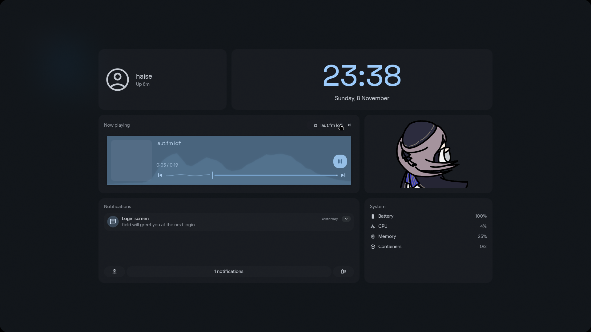
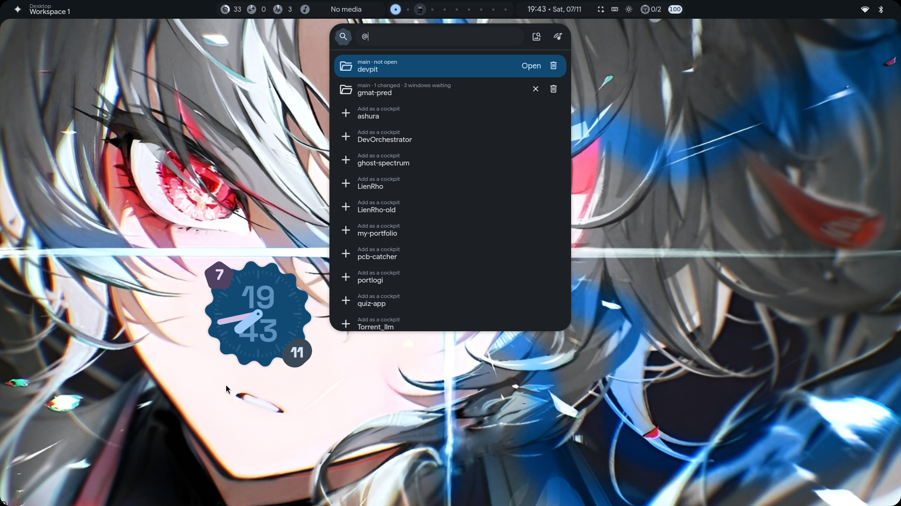
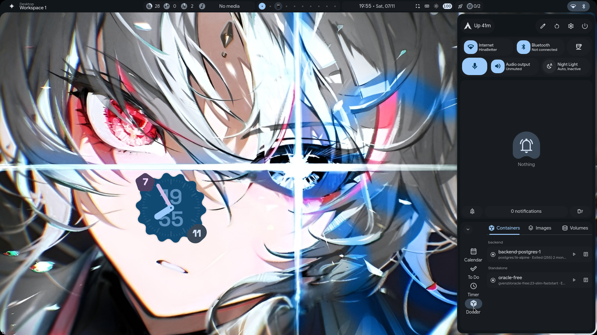
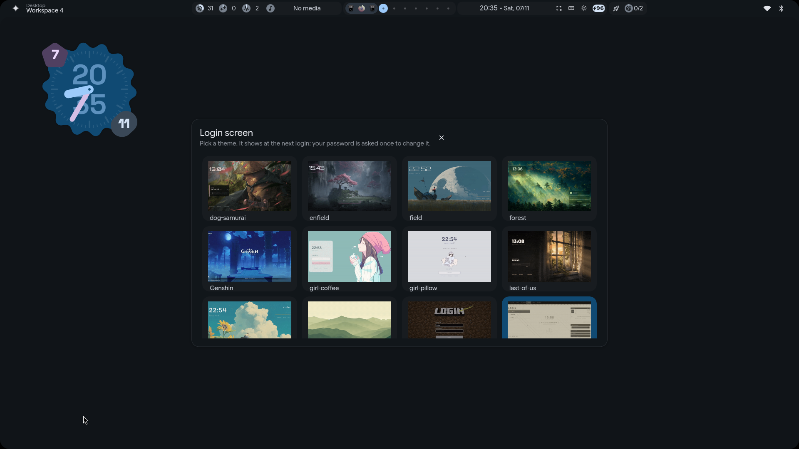
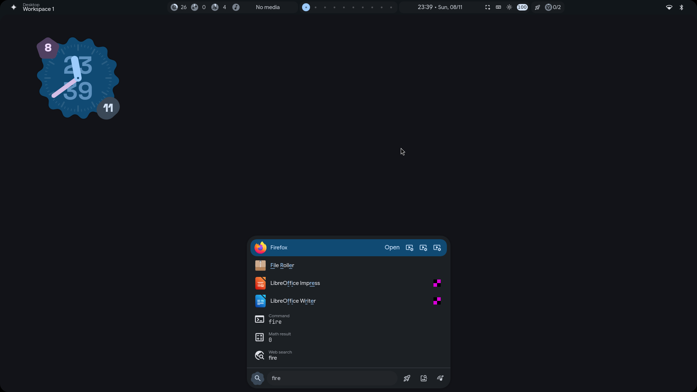

# Ashura

A Hyprland desktop built around how I work: repo cockpits that bring a
project's windows back the way I left them, Docker in the sidebar, panels that
open from the screen edges, and music that shows on the desktop while it plays.
The shell is written in QML on [Quickshell](https://quickshell.org).



## What's in it

| | |
|---|---|
| **Repo cockpits** | A space of its own, workspaces 101 to 110, apart from your own 1 to 10. Super+D goes in and out, Super+Space picks a repo, and Super+1..0 stay inside the cockpit. Everything opened there belongs to the repo on stage: switching repo parks its windows and brings the next repo's back to the same slots. Ctrl+Super+D closes a repo. Driven by [devpit](https://github.com/Haise-727/devpit), included here as a submodule. |
| **Docker** | The lower half of the right sidebar: containers grouped by compose project with start, stop, restart and logs; images and volumes with sizes. It never deletes anything. A bar pill shows running and total. |
| **Dashboard** | Hover the middle of the top edge, or click the clock. **Dashboard:** a clock inside a ring that fills as the day goes, you with your picture, a month where days with deadlines carry a dot (click a day to see, tick and add its items), and the player inside its visualizer ring. **Performance:** CPU, GPU, disks with free space, network, memory, and a battery card that fills like a battery in the colour of the power profile. **Apps:** every app as a bar as long as its memory, with its icon, CPU, and close or kill on hover. **Cockpits:** each repo's unpushed commits on a small git line, with changed files, CI, pull requests and any coding agent working in it. |
| **Edge panels** | Right edge: a dial out of the edge with volume and brightness arcs, their values riding the tips; drag or scroll to change them. Volume and brightness keys send a ripple out of the edge with the new value. Left edge: a rail of icons for the translator, booru and screen translation. Bottom edge: the music bar with lyrics and seeking. Hover the bar's volume icon for a per app mixer. Each edge can be switched in Settings, Edges. |
| **Music** | While something plays: a wave round the focused window in the border's colour, a visualizer along the bottom edge, synced lyrics on the desktop ([LRCLIB](https://lrclib.net)), and a ring round the cover in the dashboard. All of it from one shared cava, all of it off when nothing plays. Switches are in Settings, Music. |
| **Wallpapers** | Super+W picks a random one, Super+Shift+W opens a coverflow picker with Normal and Live modes. Changes are drawn: the new wallpaper's character is outlined first, or it spreads in as pixel colonies. Live mode plays videos and shader wallpapers that react to music and the mouse. Every wallpaper recolours the shell, the terminal, GTK and Qt apps. |
| **Launch workspace** | Workspace 10 is a full screen dashboard: profile, clock, media with cava, a lofi radio, notifications and system stats. |
| **Login screen picker** | `/logintheme` in search: pick any [qylock](https://github.com/Darkkal44/qylock) SDDM theme from animated previews. |
| **Lock** | An on screen keyboard on the lock screen. If the shell crashes or reloads while locked, hyprlock takes over the lock, so you can always type your password. |
| **Desktop clock** | Sits in the wallpaper's quietest spot and slides there when the wallpaper changes. |
| **One player at a time** | Starting a player pauses the others, so a video pauses the lofi radio. |
| **No Alt key needed** | Every bind works without Alt, and Right Alt acts as Super. Built for a laptop whose Alt keys failed. |

<p>
 
 
</p>

## Keys

**Super+/** shows every key with what it does. The main ones:

| Key | Does |
|---|---|
| Super (tap) | Search and the overview |
| Super+Space | Pick a cockpit (repo) |
| Super+D | Into the cockpit and back out |
| Ctrl+Super+D | Close the repo on stage |
| Ctrl+Super+Shift+D | Send a window to the same slot in the other space (3 and 103) |
| Super+W | Random wallpaper |
| Super+Shift+W | Wallpaper picker (Normal or Live) |
| Ctrl+Super+T | Grid wallpaper picker (any folder) |
| Super+Backspace | Close a window |
| Super+Shift+D | Maximize |
| Super+R | Browser |
| Super+Shift+T | Translate what is on screen |
| Ctrl+Super+Left or Right, Super+scroll, 3 finger swipe | Next or previous workspace, staying inside the current group |
| Volume keys | Steps of 5%, up to 250% |
| Super+Escape | Session menu |

## Install

Arch Linux with Hyprland 0.56 or newer (Lua config) and Quickshell:

```sh
git clone --recursive https://github.com/Haise-727/ashura
cd ashura
ashura/install.sh --dry-run   # see what it would do
ashura/install.sh
```

The installer adds the packages it needs, then backs up everything it replaces
into `~/.local/state/ashura/backup-<time>/` with a `rollback.sh`. Your own
`kitty.conf` and fish config stay. Log out and back in afterwards, using the
same Hyprland login entry.

### First login

- **Super+W** picks a wallpaper, which sets the colours for everything.
- Tap **Super** for search and the overview. **Super+/** shows every key.
- Hover the screen edges: right for volume and brightness, left for a second
  for the translator and booru, bottom for the music bar, the middle of the
  top edge for the dashboard.
- Cockpits need [devpit](https://github.com/Haise-727/devpit). The installer
  links the copy in `devpit/` when nothing else provides it.

### Updating

`ashura/sync.sh` copies the repo's Hyprland and shell files over the installed
ones and reloads Hyprland; the shell reloads itself. It never deletes files and
never touches the generated colour files. `--dry-run` lists what would change.
It refuses to run while the screen is locked, because a shell reload under the
lock drops the lock screen.

### If something goes wrong

- Run the `rollback.sh` the installer printed, then log out and in.
- A crashed lock screen fixes itself: within a few seconds a plain password
  prompt (hyprlock) takes over. Type your password and the shell comes back.

## Agenda

Deadlines and to-dos live in `~/.config/ashura/agenda.json`, one list for the
whole shell: the dashboard calendar shows and edits it, and anything else
(a checklist, reminders) can read and write the same file.

## Screen translator

Super+Shift+T reads the text on screen and translates it in place. It uses
Google Cloud, so it needs a key of your own:

1. In a Google Cloud project, enable the **Cloud Vision API** and the **Cloud
   Translation API**.
2. Create a service account with access to both, then create a JSON key for it.
3. Press Super+Shift+T, paste the whole JSON into the key box and confirm.

The key is kept in your system keyring (as "Ashura Safe Storage"), not in a file.

## Booru

The left sidebar's image board starts on Konachan, which needs no key.
Gelbooru needs an API key: copy `~/.config/ashura/booru-keys.json.example` to
`booru-keys.json`, add your key (Gelbooru, My Account, Options), then type
`/mode gelbooru`. Tags you never want to see go in
`~/.config/ashura/booru-blacklist.txt`, one per line.

## Known issues

See [ashura/ISSUES.md](ashura/ISSUES.md).

## Credits

Ashura's shell and Hyprland config began as a fork of
[end-4/dots-hyprland](https://github.com/end-4/dots-hyprland) (illogical-impulse)
and keep much of its code, under the same GPL-3.0 licence. Thanks to end-4 and
its contributors.

- [caelestia-dots/shell](https://github.com/caelestia-dots/shell): the kurukuru gif, the edge sliders, the dashboard layout and the bar attached panels.
- [diegoMalagrida/pocket-dots](https://github.com/diegoMalagrida/pocket-dots): the wallpaper transitions and the coverflow picker (after ilyamiro's).
- [Darkkal44/qylock](https://github.com/Darkkal44/qylock): the SDDM themes and their previews.
- [end-4/rounded-polygon-qmljs](https://github.com/end-4/rounded-polygon-qmljs) and [end-4/google-sans-flex](https://github.com/end-4/google-sans-flex): the shape library and the font mirror.
- Models: [BiRefNet](https://github.com/ZhengPeng7/BiRefNet) for the character outlines; [LaMa](https://github.com/advimman/lama) and [Depth Anything V2](https://github.com/DepthAnything/Depth-Anything-V2) for the depth parallax (switched off).
- [Quickshell](https://quickshell.org), [Hyprland](https://hyprland.org), [Bibata](https://github.com/ful1e5/Bibata_Cursor) cursors.
- Lofi streams: [laut.fm lofi](https://laut.fm/lofi), [Nightwave Plaza](https://plaza.one).

## Licence

GPL-3.0. See [LICENSE](LICENSE); third party licences are in [licenses/](licenses/).
